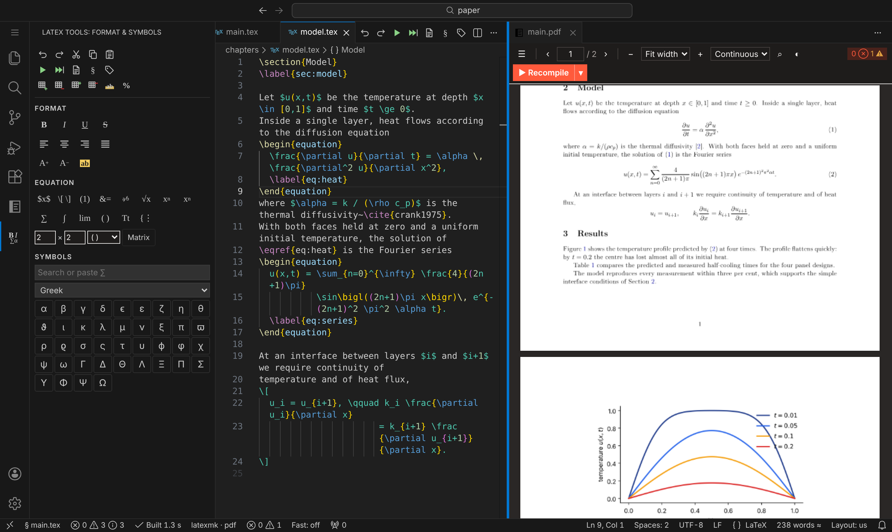
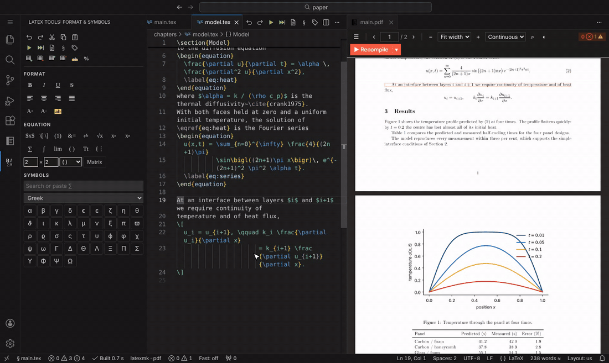
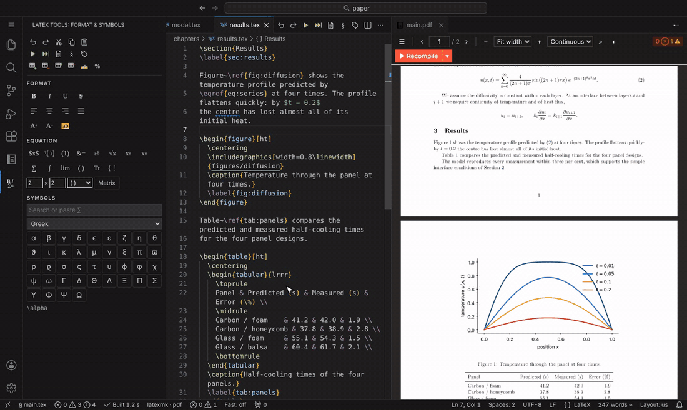
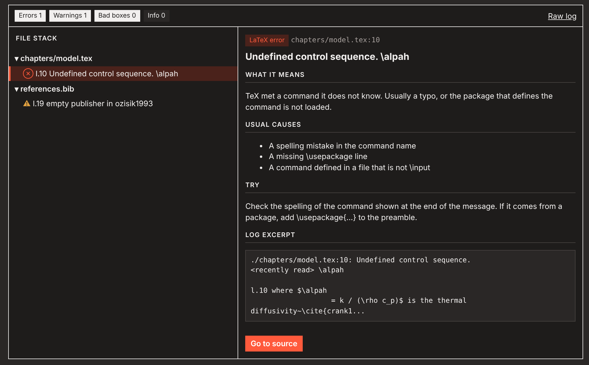
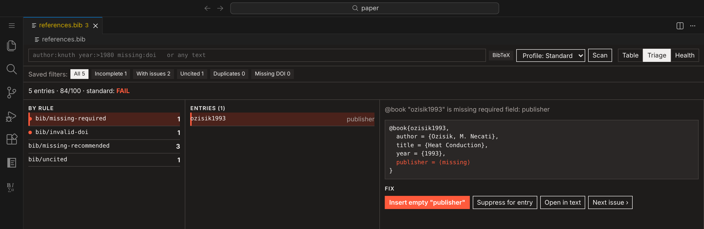
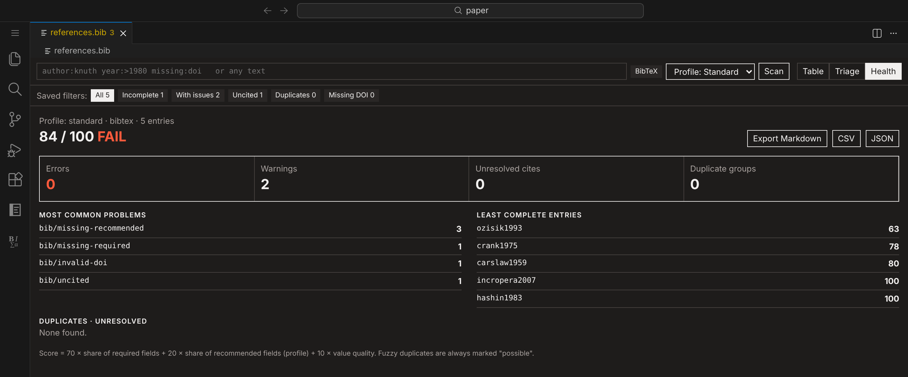
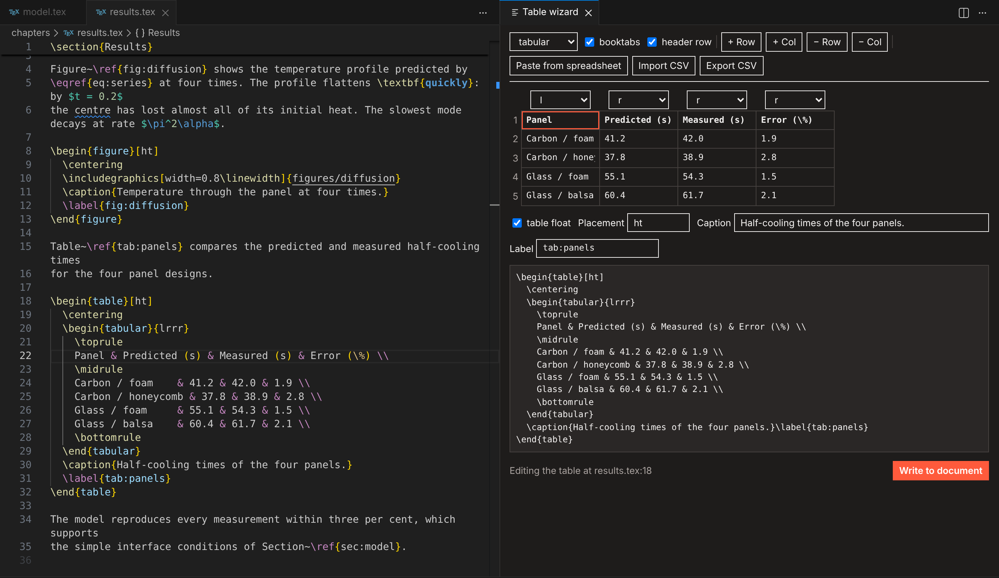
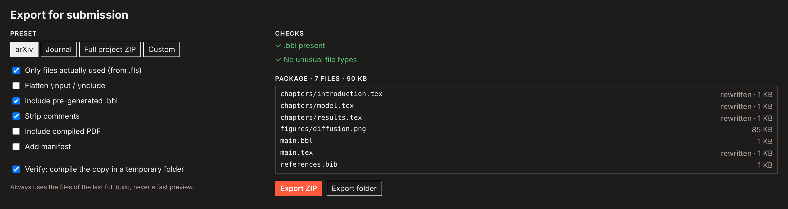
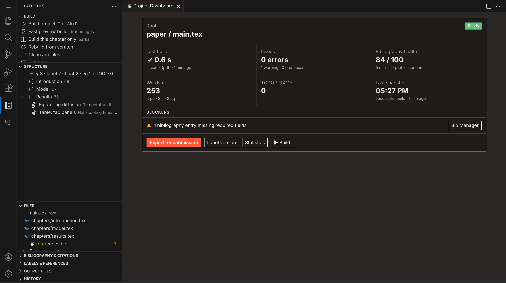
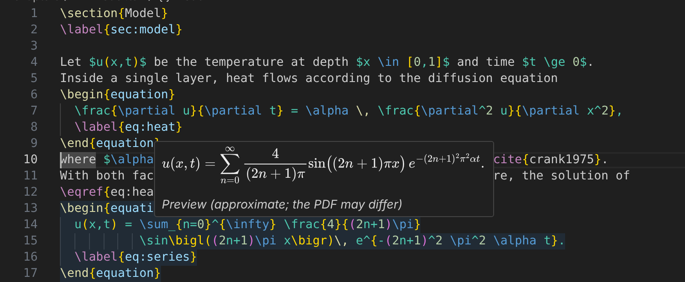

<p align="center">
  
</p>

<h1 align="center">LaTeX Desk</h1>

<p align="center">
  <b>All the LaTeX power, none of the setup, and no limits on how long your build can run.</b><br>
  Write, build, preview and submit LaTeX documents without leaving VS Code.
</p>

<p align="center">
  <a href="https://marketplace.visualstudio.com/items?itemName=esquaredsystems.latexdesk"></a>
  <a href="https://marketplace.visualstudio.com/items?itemName=esquaredsystems.latexdesk"></a>
  <a href="LICENSE"></a>
</p>



- **Your machine, your rules.** Builds run on your own TeX installation, so a 250-page thesis compiles
  as often as you like, with no queue, no timeout and no file-size cap.
- **Nothing to configure.** LaTeX Desk finds your main file, picks a recipe and opens the PDF beside
  the source on the first build.
- **Private by design.** Everything works offline, and your documents never leave your computer
  ([privacy](docs/privacy.md)).

---

## Write, save, see it

Save and the PDF rebuilds, keeping your place, and extra passes run only when they're needed. **Ctrl+click** (Cmd+click on macOS)
anywhere in the PDF to jump to the line that produced it, or press **Ctrl+Alt+J** to go the other way.



## Formatting without memorising commands

The **LaTeX Tools** bar gives you one-click bold, italic, alignment and text size, an equation
builder and a searchable symbol palette. Buttons work as toggles: click Bold on `\textbf{word}` and
it is plain again. If a button needs a package you haven't loaded, LaTeX Desk offers to add it.



## Errors explained in plain English

Every error and warning appears in the Problems view with its file and line. The log viewer
explains common ones: what went wrong, the usual causes and what to try. One click takes you to the
line.



## A bibliography you can trust

The Bib Manager checks every entry as you type: missing fields, broken DOIs, uncited and duplicate
entries. It scores each entry for completeness and walks you through the fixes one at a time.





## Tables without the ampersands

Put the cursor in a table and open the **Table Wizard**: edit cells in a grid, add or remove rows
and columns, and set alignment, caption and label. You can also paste straight from a spreadsheet
or import a CSV.



## Ready to submit

**Export for Submission** packages only the files your document actually uses, adds the `.bbl`,
can strip comments, and then compiles the copy in a clean folder. You know the upload works before
you send it. Presets cover arXiv, journals and a source ZIP.

Two one-click helpers sit in the Build view:

- **Create Source ZIP** packs every source file of the project (figures, `.bib`, `.cls`, `.sty`,
  data) into one archive for a publisher or co-author, and leaves out the compiled PDF and all
  build files. **Verify** compiles the archive's contents in a clean folder.
- **Export PDF with Watermark…** writes a copy of the built PDF with `DRAFT` (or any text) across
  every page, or in the top or bottom margin. Your PDF and your sources are not changed.



## Your project at a glance

The dashboard shows the build state, errors, bibliography health, word count, TODOs and anything
blocking submission. The side bar lists your document's structure, files, citations, labels and
history.



Hover over any formula to see it rendered, without building:



---

## Getting started

1. **Install a TeX distribution** if you don't have one:
   [MacTeX](https://tug.org/mactex/) (macOS), [MiKTeX](https://miktex.org/) or
   [TeX Live](https://tug.org/texlive/) (Windows), or TeX Live (Linux).
   Run **LaTeX Desk: Check LaTeX Tools** to confirm what was found.
2. **Open the folder** that contains your `.tex` files.
3. **Open your main file** and press **Ctrl+Alt+B** (**Cmd+Alt+B** on macOS). The PDF opens beside
   the source, and every save rebuilds it after that.

Starting fresh? **Create from Template…** (in the Build view) opens a searchable library of
journal, conference, thesis, book, slide, poster, CV and letter templates: type `ieee`, `apa`,
`thesis` or a subject, pick one, and choose a folder. Templates that publishers only offer from
their own site link there, and you can create the project from the ZIP you download. **New LaTeX
Project…** asks a few quick questions (class, engine, bibliography, layout) instead.

Editing, completion and all the checks work without TeX installed; only building needs it.
`latexmk` is used when present (it ships with all three distributions). Optional extras:
`latexindent` or `tex-fmt` for formatting, `latexdiff` for change-tracked PDFs, `texcount` for a
second word count.

LaTeX Desk finds the main document by itself. A `% !TEX root = ../main.tex` comment wins; otherwise
it picks the file that has `\documentclass` and includes the file you are editing. If several
documents qualify, it asks once. **Select Root Document** changes the choice later.

## Everything included

| Area | What you get |
|---|---|
| Build | latexmk, pdfLaTeX, XeLaTeX, LuaLaTeX, Tectonic or your own recipe; build on save; stop; clean; separate output folder; extra passes only when needed |
| Faster builds | **Build This Chapter Only** for `\include`d chapters, and a draft-image fast preview for figure-heavy documents ([measurements](docs/performance.md)) |
| PDF viewer | Zoom, fit, page layouts, search, outline, links, dark pages; keeps your place across rebuilds and never shows a half-written PDF |
| SyncTeX | Forward and reverse search, built in, across included files and output folders |
| Language | Completion for commands, environments, citations, labels, packages and files; hovers for citations, labels, images and math; go to definition; find references; rename labels, keys, commands and environments with a preview |
| Editing | Toolbars, snippets, insert, wrap, close and rename environments, `\[…\]` ↔ `equation`, automatic `\item` on Enter, table wizard |
| Checks | Unmatched environments, duplicate labels, packages loaded twice (in red, with a fix), undefined references and citations, obsolete commands, as you type |
| Spelling | Offline, prose only (commands, math, labels and the preamble are skipped), US and UK English, project and personal dictionaries |
| Bibliography | Checker with rule codes and a completeness score, quick fixes, Bib Manager (table, triage, health report), entry form, citation search, command-line checker for CI |
| History | Snapshots after each successful build, labelled versions, diff and restore, and a latexdiff PDF against any snapshot |
| Export | arXiv, journal and source-ZIP presets; only used files; optional flattening and comment stripping; test compile of the exported copy; watermarked copy of the PDF |
| Templates | Create from Template: an online library of starter and publisher templates with instant search and type filters; works offline from the last download |

Word counts and math previews are approximations and say so.

## Keyboard shortcuts

| Command | Windows / Linux | macOS |
|---|---|---|
| Build project | Ctrl+Alt+B | Cmd+Alt+B |
| Fast preview build | Ctrl+Alt+Shift+B | Cmd+Alt+Shift+B |
| View PDF | Ctrl+Alt+V | Cmd+Alt+V |
| Show position in PDF | Ctrl+Alt+J | Cmd+Alt+J |
| Stop build | Ctrl+Alt+X | Cmd+Alt+X |
| Clean auxiliary files | Ctrl+Alt+C | Cmd+Alt+C |
| Insert environment | Ctrl+Alt+E | Cmd+Alt+E |
| Wrap selection in environment | Ctrl+Alt+W | Cmd+Alt+W |
| Insert citation | Ctrl+Alt+[ | Cmd+Alt+[ |
| Close current environment | Ctrl+Alt+] | Cmd+Alt+] |

Every command is in the Command Palette under **LaTeX Desk**. In the PDF, Ctrl+click (Cmd+click)
jumps to the source; set `latexdesk.viewer.reverseSyncClick` to use double-click instead.

## Settings

Settings are under **LaTeX Desk** in the Settings editor. The ones you are most likely to change:

| Setting | Default | Meaning |
|---|---|---|
| `latexdesk.build.autoBuild` | `onSave` | `never` turns off building on save |
| `latexdesk.build.recipe` | `latexmk (pdf)` | Default recipe |
| `latexdesk.build.outDir` | (empty) | Output folder relative to the root, e.g. `build` |
| `latexdesk.rootFile` | (empty) | Fix the root document instead of detecting it |
| `latexdesk.bib.profile` | `standard` | `minimal`, `standard` or `strict` field expectations |
| `latexdesk.spell.language` | `en_US` | Dictionary; a file can choose with `% !TeX spellcheck = en_GB` |
| `latexdesk.format.tool` | `builtin` | `latexindent` or `tex-fmt` instead of the built-in formatter |
| `latexdesk.toolbar.enabled` | `true` | Editor title bar buttons; `latexdesk.toolbar.showMiniBar` controls the LaTeX Tools bar |
| `latexdesk.watermark.opacity` | `0.15` | Opacity of the watermark text |
| `latexdesk.network.enabled` | `true` | Set to `false` to stop every download (the template library is the only network feature) |

<details>
<summary><b>Your own tools and recipes</b></summary>

```jsonc
"latexdesk.build.tools": [
  { "name": "glossaries", "command": "makeglossaries", "args": ["%DOC%"], "cwd": "%OUTDIR%" }
],
"latexdesk.build.recipes": [
  { "name": "pdflatex + glossaries", "tools": ["pdflatex", "glossaries", "pdflatex"] }
]
```

Placeholders: `%DOC%` (root without extension), `%DOCFILE%`, `%DOC_EXT%`, `%DIR%` (root folder),
`%OUTDIR%`, `%PATHSEP%`. Tools run directly, never through a shell. A file can pick a recipe with
`% !LS recipe = pdflatex + glossaries`, or a program with `% !TEX program = xelatex`.

</details>

<details>
<summary><b>Bibliography rules and the command-line checker</b></summary>

Problems are reported with a code such as `bib/missing-required` or `bib/invalid-doi`. Each entry
gets a completeness score:

    score = 70 × (share of required fields present)
          + 20 × (share of recommended fields present, per profile)
          + 10 × (1 − 0.25 × number of value problems, at least 0)

To silence a rule for one entry, put a comment above it: `% bib-ignore: missing-doi`. To change a
rule everywhere: `"latexdesk.bib.rules": { "bib/missing-doi": "off" }`. The full list is in
[docs/bibliography-rules.md](docs/bibliography-rules.md).

The same checker runs on the command line, for CI or a pre-commit hook:

```sh
npx latexdesk-bibcheck references.bib --tex main.tex --profile strict --format sarif --fail-on warning
```

</details>

<details>
<summary><b>Files LaTeX Desk writes</b></summary>

- Build output next to your root document (or in `latexdesk.build.outDir`), written by TeX.
- `.latexdesk/` next to the root: `fast/` and `partial/` builds, `history/` snapshots, `snapshots/`
  (a copy of an existing PDF before the first build overwrites it), `diff/`, and `dictionary.txt`
  (project words). It has its own `.gitignore`; commit `dictionary.txt` if you want to share
  project words.

Your `.tex` and `.bib` files change only when you edit them or accept an action (quick fix, rename,
table wizard, restore), always through VS Code, so Undo works.

</details>

## Known limitations

- Fast preview and partial builds need `latexmk`; partial builds work for `\include`d files only.
- Not in this release: a visual (rich-text) editor, review comments and tracked changes, Zotero,
  online metadata lookup (DOI, arXiv) and real-time collaboration.
- Spell checking ships with English dictionaries; add others with `latexdesk.spell.dictionaryPath`.
  Language switches inside a document (`\selectlanguage`) and words with TeX accents (`M\"uller`)
  are not checked yet.
- Very large projects may notice indexing, which runs on the extension host thread
  ([details](docs/performance.md)).

Found a bug or missing feature? [Open an issue](https://github.com/esquaredsystems/latexdesk/issues).

## Contributing

Want to work on LaTeX Desk itself? See the developer guide, [README_DEV.md](README_DEV.md).

## License

Copyright (C) 2026 eSquared Systems.

LaTeX Desk is free software: you can redistribute it and/or modify it under the terms of the
GNU Affero General Public License as published by the Free Software Foundation, either version 3
of the License, or (at your option) any later version. See [LICENSE](LICENSE).

In short: you may use LaTeX Desk for any purpose, including at work. If you distribute a modified
version, or offer one to others over a network (for example in a hosted editor), you must make
its complete source available under the same license.

Versions up to and including 0.3.0 were released under the MIT license and remain available under it.

The thesis in `thesis/` (used only for testing in this repository, not shipped in the extension) is
licensed separately under CC BY-NC-ND 4.0; see [thesis/LICENSE](thesis/LICENSE).

### Included software and data

| Component | License | Used for |
|---|---|---|
| [pdf.js](https://github.com/mozilla/pdf.js) 4.10.38 | Apache-2.0 | PDF viewer |
| [MathJax](https://github.com/mathjax/MathJax-src) 3.2.2 | Apache-2.0 | Math previews in hovers |
| [nspell](https://github.com/wooorm/nspell) 2.1.5 | MIT | Spell checking |
| [JSZip](https://github.com/Stuk/jszip) 3.10.1 | MIT (dual MIT/GPLv3, used under MIT) | ZIP export and template extraction |
| [pdf-lib](https://github.com/Hopding/pdf-lib) 1.17.1 | MIT | Watermarked PDF copies |
| [Papa Parse](https://github.com/mholt/PapaParse) 5.5.3 | MIT | CSV/TSV import in the table wizard |
| [tree-kill](https://github.com/pkrumins/node-tree-kill) 1.2.2 | MIT | Stopping builds with all child processes |
| English dictionaries `en_US`, `en_GB` ([`dictionary-en`](https://github.com/wooorm/dictionaries), from [SCOWL](http://wordlist.aspell.net/)) | MIT AND BSD | Spell checking; license files ship in `dist/dictionaries/` |

The command list, symbols, error explanations, snippets and BibTeX/BibLaTeX field tables in
`data/` and `snippets/` were written for this project (the field tables follow the BibTeX and
BibLaTeX documentation) and are under the project's license (AGPL-3.0-or-later).
